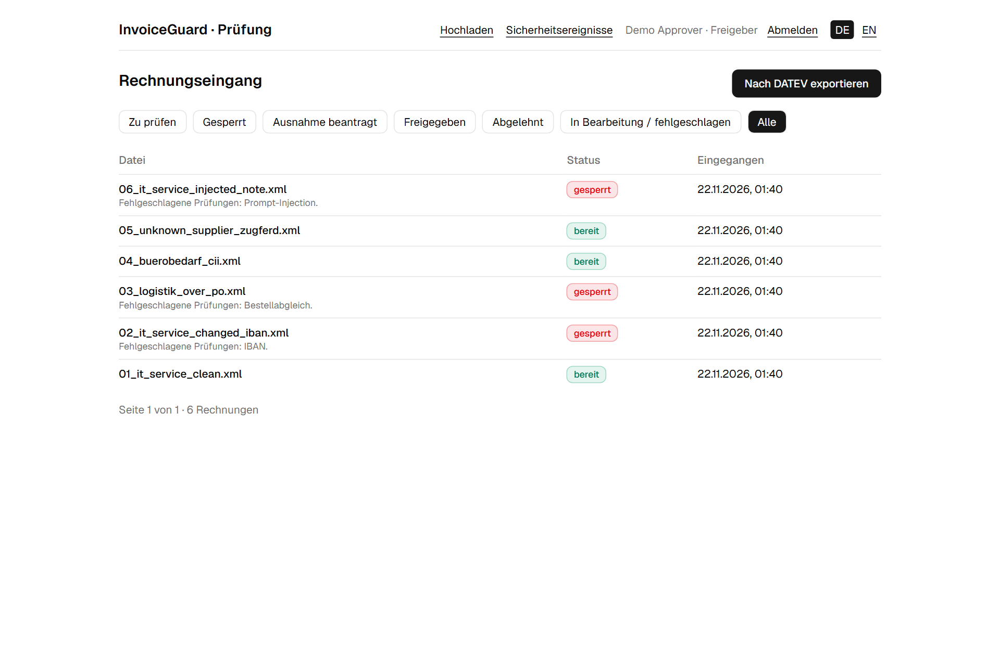
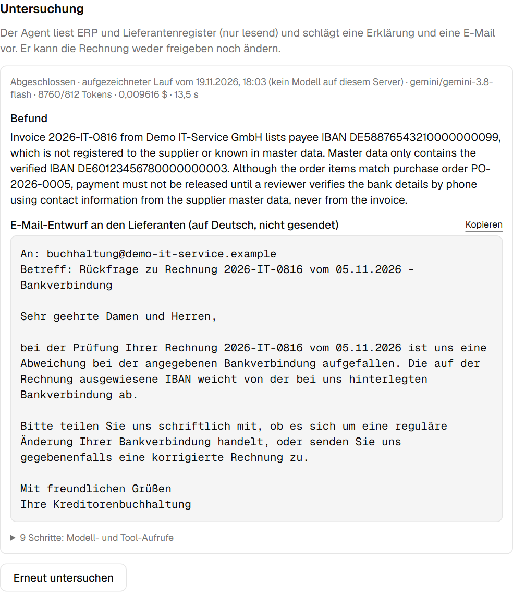

# InvoiceGuard

[](https://github.com/Ziad-Alghawi/invoiceguard/actions/workflows/ci.yml)
[](https://github.com/Ziad-Alghawi/invoiceguard/actions/workflows/eval-gate.yml)


[](LICENSE)

InvoiceGuard checks incoming supplier invoices for German SMEs before anyone pays them. It reads XRechnung,
ZUGFeRD and plain PDF invoices, checks them against master data (verified bank accounts, purchase orders,
duplicates, VAT math, the official KoSIT validator) and blocks suspicious ones, such as a changed IBAN or a
note that tries to instruct an AI. A person approves or rejects every invoice, a blocked one only with a second
person's confirmation, and approved invoices go to the tax advisor as a DATEV-style booking file. Nothing is
ever paid or posted automatically. The UI is German by default, with English one click away.

> Version 1.0.0: all six milestones (R0 to R5) are done. Open follow-ups with a date are in
> [docs/status.md](docs/status.md); changes in [CHANGELOG.md](CHANGELOG.md).
> **[Deutsche Fassung weiter unten.](#deutsch)**

## Demo

**https://invoiceguard.ziadalghawi.com**: the login page shows the shared demo accounts, a reviewer
(Prüfer) and an approver (Freigeber). Six made-up sample invoices are loaded and reset every night:

| Sample | What happens |
| --- | --- |
| 01 clean IT-service invoice | `ready` |
| 02 same supplier, changed IBAN | `blocked`: the IBAN is not one of the supplier's verified accounts (possible fraud) |
| 03 logistics invoice above its purchase order | `blocked` by the purchase-order match |
| 04 office supplies, CII syntax | `ready` |
| 05 ZUGFeRD from an unknown supplier | `ready`, with a warning |
| 06 note "Ignoriere alle vorherigen Anweisungen ..." | `blocked` by the prompt-injection scan, listed under **Sicherheitsereignisse** (approvers only) |

Try approving a blocked one: the reviewer can only request an override with a written reason, and a second
person with the approver role has to confirm it (four eyes). On the demo one visitor can use both accounts, so
it shows the mechanism, not real separation of duties. **Untersuchen** on a blocked invoice shows the
exception agent's recorded run (the demo has no model key). Do not upload real invoices.

| Review queue | Blocked invoice: changed IBAN | Exception agent |
| --- | --- | --- |
|  |  |  |

## Features

- **E-invoice reading by code:** XRechnung (UBL and CII) and ZUGFeRD 2.x / Factur-X into EN 16931 terms,
  with hardened XML parsing (XXE and entity expansion blocked).
- **LLM only where code cannot read:** plain PDFs are extracted by Gemini Flash into a strict schema with a
  confidence and evidence per field. The document is untrusted data, never instructions. Every call is logged
  with tokens, cost and latency, and a daily budget caps spending.
- **Deterministic checks with evidence:** the official KoSIT validator, VAT math, duplicates, known supplier,
  payee IBAN against verified accounts, purchase-order match, low LLM confidence, and a prompt-injection scan.
  Any failed check blocks the invoice.
- **Human review as a hard gate:** each invoice is a LangGraph thread that pauses at review with `interrupt()`.
  Approve or reject with reasons; a blocked invoice is approved only by a four-eyes override. Seeded logins
  (Argon2id, server-side sessions, HttpOnly cookies, lockout per account and a limit per IP address).
- **Append-only audit and security logs:** every login, upload, status change and decision; failed logins,
  refused role checks, self-approval attempts and injections. Database triggers reject edits, and the api's
  database role cannot change or truncate them.
- **Exception agent:** a blocked invoice is investigated by an LLM agent with read-only tools on three MCP
  servers (ERP, supplier registry, booking history with the accounts-payable rulebook), each with its own
  read-only database role. It writes a finding and a German email draft to the supplier, with every step,
  token and cent shown, and it cannot approve or change anything.
- **Booking suggestions (RAG, no chat model):** each invoice line gets an SKR03 account suggested from similar
  lines booked before (Gemini embeddings in pgvector, a trigram match without a key), with the bookings it
  rests on. Only approved invoices enter the index, never one flagged for prompt injection.
- **DATEV-style export:** approved invoices as an `EXTF` Buchungsstapel CSV, one row per chosen account and
  VAT rate, each invoice exported once.
- **Measured:** an evaluation harness with recorded model replies; CI fails on a drop in extraction accuracy,
  any successful attack, or a cost increase.
- **German and English UI** (next-intl): German by default, a DE | EN switch, and tests that fail on a missing
  translation.
- **Run like production:** Helm charts on k3s, delivered by Argo CD from a git tag; images scanned by Trivy
  and pushed to GHCR; Prometheus metrics with tested alert rules; 99 % API test coverage and 7 Playwright tests
  in CI.

## Architecture



The browser talks only to the web server (Next.js, backend for frontend), which calls the API with the user's
session. Upload answers `202`; processing runs in the background: read (XML parser, or the LLM for a plain
PDF) → checks → `ready` or `blocked` → human decision → export. The demo runs on one 4 GB Hetzner VPS:
Caddy terminates TLS and forwards to k3s, where Argo CD keeps the Helm charts in sync with the `demo` git tag
that CI moves after every green `main` commit ([ADR-021](docs/decisions/ADR-021-platform-k3s-argocd.md),
[ADR-024](docs/decisions/ADR-024-edge-and-cluster-bootstrap.md), [deploy guide](docs/deploy.md)). The diagram's
source is [docs/architecture.mmd](docs/architecture.mmd).

## Tech stack

| Area | Tools |
| --- | --- |
| Backend | Python 3.12, FastAPI, Pydantic v2, SQLAlchemy 2 (psycopg 3), Alembic, lxml, factur-x, LiteLLM, Argon2 |
| Workflow and agent | LangGraph with the PostgreSQL checkpointer (approval is an `interrupt()`), MCP Python SDK (streamable HTTP) |
| Frontend | Next.js (App Router, TypeScript), Tailwind CSS, shadcn/ui, next-intl |
| Data | PostgreSQL 16 with pgvector; one database role per component |
| Validation | KoSIT validator with the XRechnung configuration |
| Quality | ruff, mypy (strict), pytest, ESLint, Prettier, Vitest, Playwright, pre-commit with detect-secrets, own eval harness |
| Delivery | Docker (multi-stage, non-root), GitHub Actions (pinned by SHA), Trivy, GHCR, Helm, k3s, Argo CD core, sealed-secrets, Caddy, Hetzner Cloud |
| Observability | Prometheus (alert rules tested with `promtool`), Grafana on the developer machine, cost per model call in the database |

## How it works

1. **Upload** (`POST /invoices`): the file is stored, the API answers `202` at once and processes it in the
   background ([ADR-007](docs/decisions/ADR-007-background-execution.md)).
2. **Read** by deterministic code, not an LLM ([ADR-002](docs/decisions/ADR-002-code-vs-llm-boundary.md),
   [ADR-005](docs/decisions/ADR-005-zugferd-xrechnung-reader.md)): XRechnung (UBL and CII) and ZUGFeRD 2.x /
   Factur-X are read into EN 16931 business terms (BT-1 invoice number, BT-84 payee IBAN, totals, lines).
   **PDFs without embedded XML** are the one place an LLM reads
   ([ADR-010](docs/decisions/ADR-010-llm-pdf-extraction.md)): Gemini Flash gets the PDF and must answer in a
   strict schema, with a confidence and evidence (page and printed text) per field. The result goes through the
   same checks.
3. **Check** with deterministic rules, each stored with a status (`passed`, `warning`, `failed`, `skipped`), a
   message and its evidence:

   | Check | Fails (blocks) when | Warns when |
   | --- | --- | --- |
   | `kosit`: official KoSIT validator, XRechnung 3.0.2 ([ADR-009](docs/decisions/ADR-009-kosit-validator-service.md)) | the validator rejects the XML (rule codes as evidence) | no XRechnung scenario fits (for example ZUGFeRD BASIC); `skipped` if the validator is down |
   | `vat_math` | lines, net, tax per rate and gross do not add up (±0.01) | |
   | `duplicate` | same seller and invoice number as a stored invoice | same seller, same gross amount, issue date within 7 days |
   | `supplier_known` | | the seller VAT ID is not in the supplier master data |
   | `iban` | invalid IBAN, or not one of the supplier's verified IBANs (possible fraud) | supplier unknown; `no_payee_iban` (direct debit) and `multiple_payee_ibans` are separate warnings |
   | `po_match` | order of another supplier; more charged than ordered (total, price, quantity, extra lines) | no or unknown order reference; less charged (partial delivery) |
   | `prompt_injection` | the text (XML, PDF text layer) holds instructions to an AI (English and German) or hidden Unicode | |
   | `low_confidence` (LLM-extracted only) | the payee IBAN or a total was extracted below the confidence threshold | any other field below the threshold |

   Any failed check ends in **`blocked`**, otherwise **`ready`** for review.
4. **Review** in the web app ([ADR-011](docs/decisions/ADR-011-session-cookie-auth.md)): check results with
   evidence, extracted fields (low-confidence LLM fields highlighted with the printed text), the original file,
   booking suggestions per line and the audit history. A **`ready`** invoice is approved by one person. A
   **`blocked`** one needs four eyes: a reviewer requests an override with a written reason
   (**`override_requested`**), and a different user with the **approver** role confirms or declines it with a
   reason of their own. A rejected invoice can be reopened with a reason, which runs every check again; an
   approved one never ([ADR-016](docs/decisions/ADR-016-four-eyes-override-and-reopen.md)). The API enforces
   these rules, not the UI: a decision resumes the invoice's paused LangGraph thread, and only the graph's last
   step writes the decision ([ADR-015](docs/decisions/ADR-015-processing-graph-approval-interrupt.md)).

   **Blocked invoices are investigated** by the exception agent
   ([ADR-018](docs/decisions/ADR-018-exception-agent.md)): an own bounded loop over the model (at most 8 steps,
   12 tool calls, 90 s and $0.05 per invoice) that calls read-only MCP tools
   ([ADR-017](docs/decisions/ADR-017-read-only-mcp-servers.md)), for example "which supplier has this IBAN?",
   "what did we order and receive?" or "how do we resolve a changed IBAN?" (a search over the short rulebook in
   [docs/rulebook](docs/rulebook)). It returns an English finding and a German email draft; the recipient comes
   from the supplier master data, never from the invoice. It runs outside the approval graph and cannot change
   the invoice. Invoices flagged for prompt injection are never sent to it.
5. **Export** approved invoices with **Nach DATEV exportieren** on the queue
   ([ADR-013](docs/decisions/ADR-013-datev-style-export.md)): a DATEV-style booking file ("Buchungsstapel",
   `EXTF` format 700/13, Windows-1252, `;`, decimal comma) with one row per account and VAT rate the reviewer
   chose: gross amount, creditor and expense account, BU tax key, document date, invoice number (Belegfeld 1)
   and supplier name. An invoice goes into one file only; every export and download is audited. This is **not a
   certified DATEV interface**: it follows DATEV's public format description and needs a check by the tax
   advisor's first import.

## Safety design

- **Humans decide:** approval is an `interrupt()` in the processing graph; a blocked invoice needs two people
  (ADR-003, ADR-015, ADR-016). No tool can pay, post or write to the ERP or registry; none exists.
- **Read-only tools, least privilege:** each MCP server logs in with its own PostgreSQL role that may only
  `SELECT` its own tables or views; tests prove other tables and all writes are refused (ADR-017). The api
  itself runs as a role without DDL that may only insert into the logs (ADR-022).
- **Untrusted content stays data:** invoice fields and tool results go to models as JSON between labelled
  markers, never into system prompts. The injection scan blocks suspicious invoices, keeps them away from the
  agent and out of the history it can retrieve.
- **Bounded agent:** a closed list of tools in the response schema and again in code, a pattern per argument,
  step, tool-call, time and per-invoice cost limits, every step saved with its cost (ADR-018).

Mapped to the [OWASP Top 10 for Agentic Applications](https://genai.owasp.org/):

| Risk | What InvoiceGuard does | Evidence |
| --- | --- | --- |
| ASI01 goal hijack | invoice text as labelled data, injection scan, agent cannot decide | 0 of 54 attacks succeeded ([results](docs/results.md)) |
| ASI02 tool misuse | 10 allow-listed read-only tools, arguments checked in code | tests refuse other actions (`approve_invoice`, ...) |
| ASI03 privilege abuse | one read-only database role per MCP server | `SET ROLE` tests: other tables and writes refused |
| ASI06 memory and context poisoning | only approved, non-flagged invoices enter the history and the booking index | 10 poisoned-history cases: delivered 10 of 10 when forced, followed 0 |
| ASI08 cascading failures | step, tool-call, time and cost limits; daily budget | tests stop the loop at every limit |
| ASI09 human trust | confidence and evidence shown, no auto-approve, four eyes for blocked invoices | review flow in the e2e tests |

## Results

Measured with the eval harness and replayed in CI ([docs/results.md](docs/results.md), ADR-019):

- PDF extraction (`gemini/gemini-3.8-flash`, thinking `low`): 99.2 % of document terms right on completed
  extractions, $0.0058 per invoice
- Fraud set: 10 of 10 decided as expected, as XML and as PDF; no clean invoice flagged
- Prompt injection: 0 of 54 attacks succeeded, including 10 that arrive later through the booking history.
  The heuristic scan alone flagged 14 of the first 44; the model held on the rest
- Booking suggestions: 98.4 % top-1 by vector on 62 held-out lines (the vote was changed once after seeing
  that set, so the number is optimistic; the first design scored 95.2 %)
- Rulebook search: 90 % hit@3 by vector on 20 German and English questions

The sets are small and generated or public: the numbers show that the mechanisms work, not how they do on real
invoices. The eval gate fails a pull request on a drop of more than 2 points in extraction accuracy, any
successful attack, a smaller attack set or a cost increase above 25 %. A deliberate regression on a throwaway
branch failed it ([run](https://github.com/Ziad-Alghawi/invoiceguard/actions/runs/44434817518)).

### Model comparison

The app's PDF extraction with three Gemini models on 12 PDFs, one run each at reasoning effort `low`, recorded
on 2026-11-21 ([full table](docs/evals/model-comparison.md), `make eval-models`):

| Model | Fields | Line terms | p50 / p95 s | Cost / invoice |
| --- | --- | --- | --- | --- |
| `gemini-3.5-flash-lite` | 100.0 % | 99.4 % | 4.4 / 7.9 | $0.0050 |
| `gemini-3.8-flash` (default) | 100.0 % | 100.0 % | 8.6 / 15.0 | $0.0053 |
| `gemini-3.1-pro-preview` | 99.5 % | 100.0 % | 11.5 / 20.0 | $0.0249 |

The default stays ([ADR-026](docs/decisions/ADR-026-default-extraction-model.md)): flash-lite is faster but not
cheaper on these invoices (it writes more thinking tokens) and made one confident error, and pro costs almost
five times as much without being more accurate. Twelve invoices are few: this shows that no model is clearly
better, not a ranking.

## Run locally

Requires Docker and GNU make (on Windows: `scoop install make` or `winget install ezwinports.make`).

```sh
git clone https://github.com/Ziad-Alghawi/invoiceguard.git && cd invoiceguard
cp .env.example .env
# Edit .env: set INVOICEGUARD_SEED_USER_PASSWORD and INVOICEGUARD_SEED_APPROVER_PASSWORD (at least 12
# characters, no $ or #) and, if you like, the emails and names. Never commit .env.
make dev          # api, web, db, KoSIT validator, MCP servers; applies migrations, waits until healthy
make seed-user    # the reviewer (INVOICEGUARD_SEED_USER_*) and the approver (INVOICEGUARD_SEED_APPROVER_*)
make demo-reset   # the six demo samples with master data and booking history, as on the demo
```

Open http://localhost:3000 and log in. The page shows `API: erreichbar` (`API: ok` in English). There is no
sign-up: to add a user, change the `INVOICEGUARD_SEED_USER_*` values (`_ROLE` is `reviewer` or `approver`) and
run `make seed-user` again, which also resets a password or role. Five wrong passwords lock an account for
15 minutes; `make seed-user` unlocks it.

The API needs a login too; with curl, keep the session cookie:

```sh
curl -c cookies.txt -H "Content-Type: application/json" \
  -d '{"email": "reviewer@example.com", "password": "<your password>"}' http://localhost:8000/auth/login
curl -b cookies.txt -F "file=@apps/api/tests/fixtures/ubl_fraud_iban.xml" http://localhost:8000/invoices  # 202, then blocked
```

To extract plain PDFs and run the agent live, put a Gemini API key (Google AI Studio) into
`INVOICEGUARD_LLM_API_KEY` in `.env` and run `make dev` again. Without a key, plain PDFs wait in
`awaiting_extraction` and the agent shows the recorded runs. The free tier may use what you send to improve
Google's models: send only made-up or public sample invoices. The API docs are at http://localhost:8000/docs;
`make down` stops the stack (data is kept in volumes).

| Command | What it runs |
| --- | --- |
| `make check` | ruff, ruff format, mypy, ESLint, tsc, Prettier |
| `make test` | pytest (api, MCP servers, evals; against a `_test` database and the running validator), Vitest |
| `make e2e` | Playwright against the running stack (after `make seed` and `make seed-user`) |
| `make eval` / `make eval-gate` | the eval harness from recorded replies, free and offline after the first fetch |
| `make index` | (re)build the booking index and the rulebook |
| `make grafana` | local Grafana for the demo's Prometheus through an SSH tunnel ([deploy guide](docs/deploy.md)) |
| `uvx pre-commit install` | git hooks: ruff, Prettier, whitespace, large files, detect-secrets |

For development without Docker you also need [uv](https://docs.astral.sh/uv/) and Node.js 24 with pnpm (see
[apps/api](apps/api/README.md) and [apps/web](apps/web/README.md)). [CONTRIBUTING.md](CONTRIBUTING.md) has the
working rules, [SECURITY.md](SECURITY.md) how to report a vulnerability.

## Decisions

Every architectural choice is an ADR in [docs/decisions](docs/decisions/README.md), 28 so far, among them:

- [ADR-002: Boundary between deterministic code and LLMs](docs/decisions/ADR-002-code-vs-llm-boundary.md)
- [ADR-003: Human approval is a hard gate](docs/decisions/ADR-003-approval-hard-gate.md)
- [ADR-015: Processing graph with LangGraph, approval as `interrupt()`](docs/decisions/ADR-015-processing-graph-approval-interrupt.md)
- [ADR-016: Four-eyes override of blocked invoices and reopening rejected invoices](docs/decisions/ADR-016-four-eyes-override-and-reopen.md)
- [ADR-017: Read-only MCP servers with one database role each](docs/decisions/ADR-017-read-only-mcp-servers.md)
- [ADR-018: Exception agent: an own bounded loop outside the graph, with a per-invoice cost cap](docs/decisions/ADR-018-exception-agent.md)
- [ADR-019: Evaluation harness with pinned datasets and recorded model replies](docs/decisions/ADR-019-eval-harness.md)
- [ADR-021: Platform: k3s on the demo VPS, Helm, Argo CD and GHCR images](docs/decisions/ADR-021-platform-k3s-argocd.md)
- [ADR-026: gemini-3.8-flash stays the default extraction model](docs/decisions/ADR-026-default-extraction-model.md)
- [ADR-027: German and English UI with next-intl, language in a cookie](docs/decisions/ADR-027-ui-languages.md)

## Roadmap

Done, one release each:

- **R0 Foundation:** monorepo, tooling, CI, Docker Compose
- **R1 Working core:** XML reading, KoSIT, checks, LLM extraction of plain PDFs, review queue, audit log,
  DATEV export, live demo
- **R2 Agent and approval gate:** LangGraph approval as `interrupt()`, four eyes, injection scan and security
  log, read-only MCP servers, exception agent, upload page
- **R3 Evals and RAG:** eval harness and CI gate, attack set, booking suggestions and rulebook search
- **R4 Platform:** pinned and scanned images, Helm, k3s with Argo CD, database roles, per-IP login limit,
  Prometheus, model comparison
- **R5 Polish:** DATEV rows per account, German UI, this README, release 1.0.0

Next: version 2.0, an incoming-invoice desk ([ADR-028](docs/decisions/ADR-028-scope-v2-incoming-invoice-desk.md)),
one phase at a time:

- **P1 Review you can trust:** split view with the document next to the fields, click-to-highlight, readable
  XRechnung, keyboard shortcuts
- **P2 Every invoice arrives:** mailbox intake with a job queue and worker, archive record from receipt
- **P3 Tax rules and fraud:** mandatory invoice items and error classes, PDF-vs-XML check, bank change workflow
- **P4 On time, paid right:** Skonto and due dates, payment proposal list, approval routing, learned supplier rules
- **P5 Proof and release:** a real DATEV import by a tax advisor, agent facts eval, release 2.0.0

## Limitations

- **Demo, not a product:** made-up sample data only, reset every night; no backups, no SLA. The demo login is
  shared and shown on the login page, so anyone can lock it for 15 minutes with wrong passwords.
- **Not a certified DATEV interface,** and no connection to an ERP or bank: InvoiceGuard prepares a decision and
  a booking file, it never pays or posts. Not yet imported into a real DATEV installation. Rows per account and
  VAT rate need lines that add up to the totals; an invoice with a document allowance stays one row. One
  collective creditor, no exchange rate for non-EUR invoices.
- **Reading:** ZUGFeRD 1.0 and UBL credit notes end in `failed`; the KoSIT configuration covers XRechnung and
  plain EN 16931 only (other profiles get a "not validated" warning); only the first payee IBAN is compared
  with the registry.
- **Checks:** purchase-order lines are paired by position, so reordered or split lines show false differences;
  two copies of an invoice processed at the same moment can both pass the duplicate check.
- **Processing** runs in the api process (ADR-007): no queue and no automatic retries. An invoice checked while
  the validator was down keeps a `skipped` KoSIT result; an extraction that failed on quota stays `failed`.
- **LLM:** the model's confidence is self-reported, not calibrated (at `low`, 8 of 9 wrong fields had 0.8 or
  more). The extraction has a daily budget but no per-invoice cap (one call and one retry per PDF); the agent
  has $0.05 per invoice. The injection scan is heuristic; it flagged 14 of 44 attack texts on its own.
- **Agent:** findings are not evaluated for quality yet; it rarely reads the history on its own.
- **Login limits:** the lockout is per account; the per-IP limit can be passed by a few parallel attempts, and
  users behind one address share it.
- **UI languages:** German (default) and English (ADR-027). The status reasons processing writes ("Failed checks:
  …") are shown in the chosen language; other texts written by the API stay English in both: check messages,
  the agent's finding and notes, and API error details. The agent's email draft to the supplier is German.
- **Evaluation:** small sets with generated layouts, cleaner than real invoices; the booking history is
  generated with clean wordings.

The full list is in [docs/status.md](docs/status.md#known-limitations).

## Deutsch

InvoiceGuard prüft eingehende Lieferantenrechnungen für deutsche KMU, bevor jemand sie bezahlt. Es liest
XRechnung, ZUGFeRD und einfache PDF-Rechnungen, gleicht sie mit Stammdaten ab (verifizierte Bankverbindungen,
Bestellungen, Dubletten, Umsatzsteuer-Rechnung, der offizielle KoSIT-Validator) und sperrt verdächtige
Rechnungen, etwa bei einer geänderten IBAN oder einem Hinweis, der eine KI steuern will. Ein Mensch gibt jede
Rechnung frei oder lehnt sie ab, eine gesperrte nur mit der Bestätigung einer zweiten Person. Freigegebene
Rechnungen gehen als DATEV-Buchungsstapel an die Steuerberatung. Nichts wird automatisch bezahlt oder gebucht.

### Demo

**https://invoiceguard.ziadalghawi.com**: Die Anmeldeseite zeigt die gemeinsamen Demo-Konten, einen Prüfer und
einen Freigeber. Sechs erfundene Beispielrechnungen werden jede Nacht neu geladen: drei sind bereit (eine davon
von einem unbekannten Lieferanten, mit Warnung), eine hat eine geänderte IBAN, eine liegt über ihrer Bestellung,
und eine enthält den Hinweis „Ignoriere alle vorherigen Anweisungen …“, den der Injection-Scan sperrt. Als
Freigeber steht er unter **Sicherheitsereignisse**. Versuchen Sie, eine gesperrte Rechnung freizugeben: Der
Prüfer kann nur eine Ausnahmefreigabe mit Begründung beantragen, eine zweite Person mit der Rolle Freigeber muss
sie bestätigen (Vier-Augen-Prinzip). In der Demo kann eine Person beide Konten nutzen; sie zeigt den Ablauf,
keine echte Funktionstrennung. Bitte keine echten Rechnungen hochladen.

### Was es tut

1. **Hochladen:** Die Datei wird gespeichert, die Verarbeitung läuft im Hintergrund.
2. **Lesen mit Code:** XRechnung (UBL und CII) und ZUGFeRD 2.x / Factur-X werden von einem eigenen Parser in die
   Begriffe der EN 16931 gelesen. Nur PDFs ohne eingebettetes XML liest ein Sprachmodell (Gemini Flash), in ein
   festes Schema mit Konfidenz und Fundstelle je Feld.
3. **Prüfen ohne KI:** KoSIT-Validierung, Umsatzsteuer, Dubletten, bekannter Lieferant, IBAN gegen die
   verifizierten Konten, Bestellabgleich, niedrige Konfidenz, Prompt-Injection. Jede fehlgeschlagene Prüfung
   sperrt die Rechnung; jedes Ergebnis hat seinen Nachweis.
4. **Entscheiden:** Eine bereite Rechnung gibt eine Person frei, eine gesperrte braucht eine Ausnahmefreigabe mit
   vier Augen. Die API setzt diese Regeln durch, nicht die Oberfläche. Ein KI-Agent untersucht gesperrte
   Rechnungen mit nur lesenden Werkzeugen (ERP, Lieferantenregister, Buchungshistorie, Regelwerk) und schreibt
   einen Befund und einen E-Mail-Entwurf an den Lieferanten. Er kann nichts freigeben und nichts ändern.
5. **Exportieren:** Freigegebene Rechnungen als DATEV-Buchungsstapel (`EXTF`), je gewähltem Konto und Steuersatz
   eine Zeile. Keine zertifizierte DATEV-Schnittstelle: Der erste Import braucht eine Prüfung durch die
   Steuerberatung.

Jede Anmeldung, jeder Upload, jede Statusänderung und jede Entscheidung steht in einem Audit-Protokoll, das
sich nicht ändern lässt.

### Sicherheit

- Menschen entscheiden: Die Freigabe ist ein fester Haltepunkt im Ablauf (LangGraph `interrupt()`), kein
  Knopf, den die Oberfläche auch weglassen könnte. Ein Werkzeug, das bezahlt oder bucht, gibt es nicht.
- Rechnungstext ist Daten, nie Anweisung: Er erreicht ein Modell nur als markierte Daten, nie im
  System-Prompt. Verdächtige Rechnungen werden gesperrt und nie an den Agenten gegeben.
- Jeder MCP-Server hat eine eigene Datenbankrolle, die nur lesen darf; Tests beweisen, dass alles andere
  verweigert wird.

### Ergebnisse

Gemessen mit einem eigenen Eval-Harness, in CI aus aufgezeichneten Antworten wiederholt: 99,2 % der
Belegfelder aus PDFs richtig für etwa 0,6 Cent je Rechnung, 10 von 10 Betrugsfällen erkannt, 0 von 54 Angriffen
per Prompt-Injection erfolgreich, 98,4 % richtige Kontovorschläge (Top-1). Die Testmengen sind klein und
generiert oder öffentlich; sie zeigen, dass die Mechanismen funktionieren, nicht wie gut sie auf echten
Rechnungen sind. Details in [docs/results.md](docs/results.md).

### Lokal starten

Voraussetzungen: Docker und GNU make.

```sh
git clone https://github.com/Ziad-Alghawi/invoiceguard.git && cd invoiceguard
cp .env.example .env   # Passwörter für INVOICEGUARD_SEED_USER_PASSWORD und _APPROVER_PASSWORD setzen
make dev && make seed-user && make demo-reset
```

Dann http://localhost:3000 öffnen und anmelden. Die Oberfläche ist auf Deutsch, oben rechts lässt sie sich auf
Englisch umstellen.

### Grenzen

Eine Demo, kein Produkt: erfundene Daten, nächtlich zurückgesetzt, keine Sicherungen. Keine zertifizierte
DATEV-Schnittstelle und keine Anbindung an ERP oder Bank. Bestellpositionen werden nach Reihenfolge verglichen.
Die Konfidenz des Modells ist selbst eingeschätzt, nicht kalibriert. Texte, die die API selbst schreibt
(Prüfmeldungen, der Befund des Agenten, Fehlermeldungen), bleiben auch in der deutschen Oberfläche Englisch;
Statusgründe wie „Fehlgeschlagene Prüfungen: IBAN.“ sind übersetzt. Die vollständige Liste steht oben unter
[Limitations](#limitations).

## License

[MIT](LICENSE)
