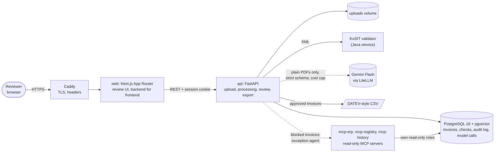

# InvoiceGuard

[](https://github.com/Ziad-Alghawi/invoiceguard/actions/workflows/ci.yml)


[](LICENSE)

InvoiceGuard checks incoming supplier invoices for German SMEs before anyone pays them. It reads XRechnung,
ZUGFeRD and plain PDF invoices, checks them against master data (verified bank accounts, purchase orders,
duplicates, VAT math, the official KoSIT validator) and blocks suspicious ones, such as a changed IBAN. A
human reviewer approves or rejects every invoice with an audit trail and exports approved ones as a DATEV-style
booking file. Nothing is ever paid or posted automatically.

> Status: R0 (foundation) and R1 (working core with a live demo) are done. R2 adds the agent and approval gate.

## Demo

**https://invoiceguard.ziadalghawi.com**: the login page shows the shared demo accounts, a reviewer and an
approver. Six made-up sample invoices are loaded and reset every night: two ready, one with a changed bank account
(possible fraud), one charging more than its purchase order, one from an unknown supplier, and one whose note tries
to instruct an AI ("Ignoriere alle vorherigen Anweisungen ..."), which the injection scan blocks. Log in as the
approver to see it under **Security events**. Try approving a
blocked one: the reviewer can only request an override with a written reason, and a second person with the
approver role has to confirm it (four eyes). On the demo one visitor can use both accounts, so it shows the
mechanism, not real separation of duties.

| Review queue | Blocked invoice: changed IBAN |
| --- | --- |
|  |  |

## Features

- **E-invoice reading by code:** XRechnung (UBL and CII) and ZUGFeRD 2.x / Factur-X into EN 16931 terms, with
  hardened XML parsing (XXE and entity expansion blocked).
- **LLM only where code cannot read:** plain PDFs are extracted by Gemini Flash into a strict schema with
  confidence and evidence per field; the document is untrusted data, never instructions. Every call is logged
  with tokens, cost and latency, and a daily budget caps spending.
- **Deterministic checks with evidence:** official KoSIT validator, VAT math, duplicates, known supplier, payee
  IBAN against verified accounts, purchase order match, low LLM confidence. Any failed check blocks the invoice.
- **Human review as a hard gate:** seeded logins (Argon2id, server-side sessions, HttpOnly Secure cookies,
  lockout), approve or reject with reasons; a blocked invoice is approved only by a four-eyes override: a reason
  from one user, then a confirmation by a different user with the approver role.
- **Append-only audit log:** every login, upload, status change and decision; a database trigger rejects edits.
- **Prompt-injection scan and security log:** the invoice text (XML and the PDF text layer) is scanned by code for
  instructions to an AI (English and German) and hidden Unicode characters; a hit blocks the invoice. Failed logins,
  lockouts, refused role checks, self-approval attempts and injections go to an append-only security log that
  approvers can read.
- **Exception agent:** a blocked invoice is investigated by an LLM agent with read-only tools on three MCP servers
  (ERP, supplier registry, and booking history with the accounts-payable rulebook; each with its own read-only
  database role). It writes a finding for the reviewer and a German email draft to the supplier, with every step,
  token and cent shown; it cannot approve or change anything.
- **Booking suggestions (RAG, no chat model):** each invoice line gets an SKR03 account suggested from the
  accounts booked for similar lines before (Gemini embeddings in pgvector, a trigram text match without a key),
  with the bookings it rests on. The reviewer picks the account per line when approving; only approved invoices
  enter the index, never one flagged for prompt injection. 98 % top-1 on a held-out set ([results](docs/results.md)).
- **DATEV-style export:** approved invoices as an `EXTF` Buchungsstapel CSV, one row per chosen account and VAT
  rate, each invoice exported once.
- **Built like production:** typed Python and TypeScript, 99 % API test coverage, Playwright E2E test, CI on
  every PR, Docker Compose, deployed behind Caddy with HTTPS.

## Architecture



Upload answers `202` and processing runs in the background: read (XML parser or LLM) → checks → `ready` or
`blocked` → human decision → export. The browser never talks to the API directly; the web server calls it with
the user's session. The public demo runs this stack on one VPS with Docker Compose
([ADR-014](docs/decisions/ADR-014-demo-hosting-single-vps.md), [deploy guide](docs/deploy.md)).

## Tech stack

| Area | Tools |
| --- | --- |
| Backend | Python 3.12, FastAPI, Pydantic v2, SQLAlchemy 2 (psycopg 3), Alembic, lxml, factur-x, LiteLLM, Argon2 |
| Frontend | Next.js (App Router, TypeScript), Tailwind CSS, shadcn/ui |
| Data | PostgreSQL 16 with pgvector |
| Validation | KoSIT validator with the XRechnung configuration |
| Quality | ruff, mypy (strict), pytest, ESLint, Prettier, Vitest, Playwright, pre-commit with detect-secrets |
| Delivery | Docker (multi-stage, non-root), Docker Compose, GitHub Actions, Caddy, Hetzner Cloud |
| Workflow | LangGraph with the PostgreSQL checkpointer; approval is an `interrupt()` |
| Agent tools | MCP Python SDK (streamable HTTP), one read-only PostgreSQL role per server |
| Planned | Langfuse, Helm, Argo CD (R3 to R4) |

## How it works

1. **Upload** (`POST /invoices`): the file is stored, the API answers `202` at once and processes it in the
   background ([ADR-007](docs/decisions/ADR-007-background-execution.md)).
2. **Read** by deterministic code, not an LLM ([ADR-002](docs/decisions/ADR-002-code-vs-llm-boundary.md),
   [ADR-005](docs/decisions/ADR-005-zugferd-xrechnung-reader.md)): XRechnung (UBL and CII) and ZUGFeRD 2.x /
   Factur-X are read into EN 16931 business terms (BT-1 invoice number, BT-84 payee IBAN, totals, lines).
   **PDFs without embedded XML** are the one place an LLM reads ([ADR-010](docs/decisions/ADR-010-llm-pdf-extraction.md)):
   Gemini Flash gets the PDF and must answer in a strict schema, with a confidence and evidence (page and printed
   text) per field. The PDF is treated as untrusted data, and the result goes through the same checks. Every model
   call is logged with tokens, cost and latency; `GET /invoices/{id}` shows the cost per invoice.
3. **Check** with deterministic rules, each stored with a status (`passed`, `warning`, `failed`, `skipped`), a message
   and its evidence:

   | Check | Fails (blocks) when | Warns when |
   | --- | --- | --- |
   | `kosit`: official KoSIT validator, XRechnung 3.0.2 ([ADR-009](docs/decisions/ADR-009-kosit-validator-service.md)) | the validator rejects the XML (rule codes as evidence) | no XRechnung scenario fits (for example ZUGFeRD BASIC); `skipped` if the validator is down |
   | `vat_math` | lines, net, tax per rate and gross do not add up (±0.01) | |
   | `duplicate` | same seller and invoice number as a stored invoice | same seller, same gross amount, issue date within 7 days |
   | `supplier_known` | | the seller VAT ID is not in the supplier master data |
   | `iban` | invalid IBAN, or not one of the supplier's verified IBANs (possible fraud) | supplier unknown; `no_payee_iban` (direct debit) and `multiple_payee_ibans` are separate warnings |
   | `po_match` | order of another supplier; more charged than ordered (total, price, quantity, extra lines) | no or unknown order reference; less charged (partial delivery) |
   | `low_confidence` (LLM-extracted only) | the payee IBAN or a total was extracted below the confidence threshold | any other field below the threshold |

   Any failed check ends in **`blocked`**, otherwise **`ready`** for review. `GET /invoices/{id}` returns the results,
   worst first.
4. **Review** in the web app: a seeded reviewer logs in ([ADR-011](docs/decisions/ADR-011-session-cookie-auth.md)),
   works through the queue and opens an invoice: check results with evidence, extracted fields (low-confidence LLM
   fields highlighted with the printed text), the original file and the audit history. A **`ready`** invoice can be
   approved by one person. A **`blocked`** one needs four eyes: a reviewer requests an override with a written
   reason (**`override_requested`**), and a different user with the **approver** role confirms it (`approved`) or
   declines it (back to `blocked`), with a reason of their own; the requester can never confirm their own request.
   Any of them can be rejected with a reason, and a rejected invoice can be reopened with a reason: its checks run
   again and it is back in review; an approved one never ([ADR-016](docs/decisions/ADR-016-four-eyes-override-and-reopen.md)).
   The API enforces these rules, not the UI. Each invoice is a LangGraph thread that pauses at review with
   `interrupt()`; a decision resumes it, and only the graph's last step writes the decision's status
   ([ADR-015](docs/decisions/ADR-015-processing-graph-approval-interrupt.md)). Every
   login, failed login, logout, upload, status change, override and decision is written to an append-only audit
   log (a database trigger rejects changes).

   **Blocked invoices are investigated** by the exception agent ([ADR-018](docs/decisions/ADR-018-exception-agent.md)):
   an own bounded loop over the model (at most 8 steps, 12 tool calls, 90 s and $0.05 per invoice) that calls
   read-only MCP tools ([ADR-017](docs/decisions/ADR-017-read-only-mcp-servers.md)), for example "which supplier
   has this IBAN?", "what did we order and receive?", "what did this supplier invoice before?" or "how do we resolve
   a changed IBAN?" (a search over the short rulebook in [docs/rulebook](docs/rulebook)). It returns an English finding and a German email draft;
   the recipient comes from the supplier master data, never from the invoice. It runs outside the approval graph and
   cannot change the invoice. Invoices flagged for prompt injection are never sent to it. On the public demo (no model
   key) the "Investigate" button shows a recorded real run for the sample invoices, labelled as recorded.
5. **Export** approved invoices to accounting with **Export to DATEV** on the queue
   ([ADR-013](docs/decisions/ADR-013-datev-style-export.md)): a DATEV-style booking file ("Buchungsstapel", `EXTF`
   format 700/13, Windows-1252, `;`, decimal comma) with one row per account and VAT rate the reviewer chose
   (one row per invoice without chosen accounts, or when the lines do not add up to the totals): gross amount,
   creditor and expense account, BU tax key, document date, invoice number (Belegfeld 1) and supplier name.
   Accounts, advisor and client number and the tax keys are settings (`INVOICEGUARD_DATEV_*` in `.env`), the
   expense account for invoices without chosen accounts. An invoice goes into one file only; the
   file is stored and can be downloaded again, and every export and download is audited. This is **not a certified
   DATEV interface**: it follows DATEV's public format description and needs a check by the tax advisor's first
   import.

## Safety design

- **Humans decide:** approval is an `interrupt()` in the processing graph; a blocked invoice needs two people
  (ADR-003, ADR-015, ADR-016). No tool can pay, post or write to the ERP or registry; none exists.
- **Read-only tools, least privilege:** each MCP server logs in with its own PostgreSQL role that may only `SELECT`
  its own tables (the registry server sees four supplier columns; the history server sees views of approved history
  and the rulebook, never the invoices table); tests prove other tables and all writes are refused (ADR-017).
- **Untrusted content stays data:** invoice fields and tool results, history and rulebook text included, go to
  models as JSON between labelled markers, never into system prompts; the injection scan blocks suspicious invoices,
  keeps them away from the agent and out of the history it can retrieve.
- **Bounded agent:** a closed list of tools in the response schema and again in code, step, tool-call, time and
  per-invoice cost limits, every step saved with its cost (ADR-018).

_The full OWASP Agentic Top 10 mapping comes with the attack set in R3._

## Results

Measured with the eval harness and replayed in CI ([docs/results.md](docs/results.md), ADR-019):

- PDF extraction (`gemini/gemini-3.8-flash`, thinking `low`): 99.2 % of document terms right on completed
  extractions, $0.0058 per invoice
- Fraud set: 10 of 10 decided as expected, as XML and as PDF; no clean invoice flagged
- Prompt injection: 0 of 54 attacks succeeded, including 10 that arrive later through the booking history
- Booking suggestions: 98.4 % top-1 by vector on 62 held-out lines
- Rulebook search: 90 % hit@3 by vector on 20 German and English questions

The sets are small and generated or public; the numbers show the mechanisms work, not how they do on real invoices.

## Model comparison

The app's PDF extraction with three Gemini models on 12 PDFs (the 6 demo samples drawn as PDFs, plus 6
from the eval set), one run each at reasoning effort `low`, recorded on 2026-11-21. Full table:
[docs/evals/model-comparison.md](docs/evals/model-comparison.md); rerun it from the recordings with
`make eval-models`.

| Model | Fields | Line terms | p50 / p95 s | Cost / invoice |
| --- | --- | --- | --- | --- |
| `gemini-3.5-flash-lite` | 100.0 % | 99.4 % | 4.4 / 7.9 | $0.0050 |
| `gemini-3.8-flash` (default) | 100.0 % | 100.0 % | 8.6 / 15.0 | $0.0053 |
| `gemini-3.1-pro-preview` | 99.5 % | 100.0 % | 11.5 / 20.0 | $0.0249 |

The default stays (ADR-026): flash-lite is faster but not cheaper on these invoices and made one confident
error, and pro costs almost five times as much without being more accurate. Twelve invoices are few: this
shows that no model is clearly better, not a ranking.

## Run locally

Requires Docker and GNU make (on Windows: `scoop install make` or `winget install ezwinports.make`).

```sh
git clone https://github.com/Ziad-Alghawi/invoiceguard.git && cd invoiceguard
cp .env.example .env
# Edit .env: set INVOICEGUARD_SEED_USER_PASSWORD and INVOICEGUARD_SEED_APPROVER_PASSWORD (at least 12
# characters, no $ or #) and, if you like, the emails and names. Never commit .env.
make dev        # api + web + db + KoSIT validator, applies migrations, waits until all are healthy
make seed       # German demo suppliers, verified bank accounts and purchase orders (safe to rerun)
make seed-user  # the reviewer (INVOICEGUARD_SEED_USER_*) and the approver (INVOICEGUARD_SEED_APPROVER_*)
```

There is no sign-up: to add another user, change the `INVOICEGUARD_SEED_USER_*` values (`_ROLE` is `reviewer` or
`approver`) and run `make seed-user` again; a rerun also resets a password or role. Five wrong passwords in a row
lock an account for 15 minutes; `make seed-user` unlocks it.

Open http://localhost:3000: the page shows `API: erreichbar` (`API: ok` after switching to English). The API needs a login, so log in with curl and keep the
session cookie, then upload e-invoices (XML or PDF):

```sh
curl -c cookies.txt -H "Content-Type: application/json" \
  -d '{"email": "reviewer@example.com", "password": "<your password>"}' http://localhost:8000/auth/login
curl -b cookies.txt -F "file=@apps/api/tests/fixtures/ubl_xrechnung.xml" http://localhost:8000/invoices   # 202
curl -b cookies.txt -F "file=@apps/api/tests/fixtures/ubl_fraud_iban.xml" http://localhost:8000/invoices  # → blocked
```

Then open http://localhost:3000/invoices, log in with the same account, and approve or reject them. The changed-IBAN
invoice is `blocked`: the reviewer requests an override with a reason, then log in as the approver to confirm or
decline it. Each invoice page shows its audit history.

Click **Export to DATEV** on the queue to download the approved invoices as `EXTF_Buchungsstapel_<time>.csv`. It
opens in Excel or LibreOffice (separator `;`, encoding Windows-1252) and imports into DATEV as a Buchungsstapel.
The same file is also available through the API: `curl -b cookies.txt -X POST http://localhost:8000/exports/datev`
returns its `file_url`.

To extract plain PDFs, put a Gemini API key (Google AI Studio) into `INVOICEGUARD_LLM_API_KEY` in `.env` and run
`make dev` again. Without a key, plain PDFs wait in `awaiting_extraction`. The free tier may use what you send to
improve Google's models: send only made-up or public sample invoices.

The API docs are at http://localhost:8000/docs. `make down` stops the stack (data is kept in volumes).

For development without Docker you also need [uv](https://docs.astral.sh/uv/) and Node.js 24 with pnpm
(see [apps/api](apps/api/README.md) and [apps/web](apps/web/README.md)):

| Command | What it runs |
| --- | --- |
| `make check` | ruff, ruff format, mypy, eslint, tsc, prettier |
| `make test` | pytest (against a `_test` database and the validator in the running stack), vitest |
| `make e2e` | Playwright browser test against the running stack (after `make seed` and `make seed-user`) |
| `make eval` | evaluation harness (R3) |
| `make demo-reset` | resets the local stack as the public demo's nightly reset does; the demo runs on k3s ([deploy guide](docs/deploy.md)) |
| `uvx pre-commit install` | git hooks: ruff, prettier, whitespace, large files, detect-secrets |

## Decisions

Architectural choices are recorded as ADRs in [docs/decisions](docs/decisions/README.md):

- [ADR-001: Technology stack](docs/decisions/ADR-001-stack.md)
- [ADR-002: Boundary between deterministic code and LLMs](docs/decisions/ADR-002-code-vs-llm-boundary.md)
- [ADR-003: Human approval is a hard gate](docs/decisions/ADR-003-approval-hard-gate.md)
- [ADR-004: Model router with LiteLLM](docs/decisions/ADR-004-model-router.md)
- [ADR-005: Reading ZUGFeRD and XRechnung with factur-x and an own lxml parser](docs/decisions/ADR-005-zugferd-xrechnung-reader.md)
- [ADR-006: Demo authentication with seeded email/password users](docs/decisions/ADR-006-demo-auth.md)
- [ADR-007: Background execution with FastAPI BackgroundTasks and a status column](docs/decisions/ADR-007-background-execution.md)
- [ADR-008: Synchronous SQLAlchemy 2 with psycopg 3](docs/decisions/ADR-008-sync-database-access.md)
- [ADR-009: KoSIT validator as its own service, called over HTTP](docs/decisions/ADR-009-kosit-validator-service.md)
- [ADR-010: LLM extraction of plain PDF invoices](docs/decisions/ADR-010-llm-pdf-extraction.md)
- [ADR-011: Server-side sessions in an HttpOnly cookie, with a lockout](docs/decisions/ADR-011-session-cookie-auth.md)
- [ADR-012: Review decisions in R1: a status change by one reviewer, override with a reason](docs/decisions/ADR-012-review-decisions-in-r1.md)
- [ADR-013: DATEV-style booking export (EXTF Buchungsstapel), one row per invoice](docs/decisions/ADR-013-datev-style-export.md)
- [ADR-014: R1 demo on one VPS with Docker Compose and Caddy](docs/decisions/ADR-014-demo-hosting-single-vps.md)
- [ADR-015: Processing graph with LangGraph, approval as `interrupt()`](docs/decisions/ADR-015-processing-graph-approval-interrupt.md)
- [ADR-016: Four-eyes override of blocked invoices and reopening rejected invoices](docs/decisions/ADR-016-four-eyes-override-and-reopen.md)
- [ADR-017: Read-only MCP servers with one database role each](docs/decisions/ADR-017-read-only-mcp-servers.md)
- [ADR-018: Exception agent: an own bounded loop outside the graph, with a per-invoice cost cap](docs/decisions/ADR-018-exception-agent.md)
- [ADR-019: Evaluation harness with pinned datasets and recorded model replies](docs/decisions/ADR-019-eval-harness.md)
- [ADR-020: Booking suggestions by retrieval over pgvector, with Gemini embeddings](docs/decisions/ADR-020-booking-suggestions-pgvector.md)

## Roadmap

- R0 Foundation: repo, tooling, CI, Docker Compose
- R1 Working core: parsing, validation, checks, review queue, CSV export, live demo
- R2 Agent, MCP servers, approval gate, injection defence
- R3 Evals, RAG booking suggestions, CI quality gate
- R4 Platform: Helm, Argo CD, observability, model router, n8n
- R5 Polish: German UI, README EN + DE, demo video

## Limitations

- **Demo, not a product:** the public demo holds made-up sample data only and is reset every night. Do not
  upload real invoices. Its login is shared and shown on the login page, so anyone can lock it for 15 minutes
  with wrong passwords. One small server, no backups, no SLA.
- **Not a certified DATEV interface** (details below), and no connection to an ERP or bank: InvoiceGuard
  prepares a decision and a booking file, it never pays or posts.
- ZUGFeRD 1.0 (superseded in 2019) and UBL credit notes are not read; they end in `failed` with a reason.
- Only the first payee IBAN is stored and checked when an invoice names several; the others are flagged as a
  `multiple_payee_ibans` warning, not compared with the registry.
- PO matching pairs invoice lines with order lines **by position** (first with first). A supplier who reorders or
  splits lines gets false differences. Matching by item ID (BT-155/BT-156) or the order line reference (BT-132) is
  the planned fix.
- The duplicate check can miss a duplicate when two copies are processed at the same moment (each sees no other
  stored invoice yet). Unlikely at demo load; a unique constraint or a lock per seller would close it.
- The KoSIT configuration covers XRechnung and plain EN 16931; other ZUGFeRD profiles get a "not validated" warning.
- Background processing runs inside the API process (ADR-007): one API instance only, no automatic retries
  (an invoice checked while the validator was down keeps its `skipped` KoSIT result, and an extraction that hit the
  LLM quota stays `failed`).
- LLM extraction: the model's confidence is self-reported, not calibrated (R3 measures it); a PDF without a
  readable total or invoice number ends in `failed`; the Gemini free tier is for sample data only; there is a per-day cost cap
  (`INVOICEGUARD_LLM_DAILY_BUDGET_USD`) but no per-invoice cap yet (R2), and PDFs held back by the cap are only
  picked up again when the API restarts.
- Review: two roles, reviewer and approver; on the public demo one visitor can use both accounts. Approvals are
  final; only rejected invoices can be reopened. The lockout is per account, so anyone who knows a demo email can
  lock it for 15 minutes; there is no per-IP rate limit.
- Upload: one file at a time on the upload page. The public demo accepts XRechnung XML and ZUGFeRD / Factur-X PDFs
  with embedded XML only (no visitor's PDF goes to a model), at most 30 uploads per hour per shared demo
  account, and the nightly reset deletes every upload.
- UI languages: German (default) and English, switched in the header (ADR-027). The status reasons processing
  writes ("Failed checks: …") are shown in the chosen language; other texts written by the API stay English in
  both: check messages, the agent's finding and notes, and API error details. The agent's email draft to the
  supplier is German.
- DATEV export: not certified and not yet imported into a real DATEV installation. Rows per chosen account and
  VAT rate need lines that add up to the totals: an invoice with a document allowance or charge stays one row and
  the advisor splits it; invoices approved without accounts are one row, so several VAT rates there (or lines
  without a rate) get no tax key; one collective creditor for all invoices; no exchange rate for non-EUR invoices;
  invoice numbers lose characters DATEV does not allow in Belegfeld 1 (they become `-`).

## Deutsch

_Kommt in R5._

## License

[MIT](LICENSE)
