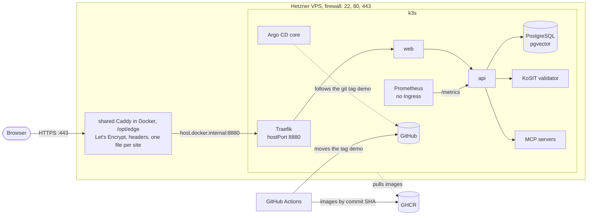

# Deploying the public demo

The demo runs on one Hetzner Cloud VPS (`invoiceguard`, CX23: 2 vCPU, 4 GB RAM, 2 GB swap, Ubuntu 24.04) as a
one-node **k3s** cluster, deployed by **Argo CD** from this repository
([ADR-021](decisions/ADR-021-platform-k3s-argocd.md), [ADR-024](decisions/ADR-024-edge-and-cluster-bootstrap.md)).
A shared **Caddy** in Docker (`/opt/edge`, from [`infra/edge`](../infra/edge)) is the server's only public entry:
it holds the TLS certificates of every site on the server and forwards the demo to k3s's Traefik.



Placeholders: `<IP>` is the server's IPv4 address, `invoiceguard.ziadalghawi.com` the demo's host name.

## 1. How a change reaches the demo

1. A pull request is merged to `main`.
2. CI on `main` runs every job, builds the six images, scans them with Trivy and pushes them to GHCR as
   `ghcr.io/ziad-alghawi/invoiceguard-<name>:<commit SHA>`.
3. The job `demo-tag` moves the git tag `demo` to that commit, once every other job has passed. It never moves
   the tag to an older commit.
4. Argo CD checks the repository about every three minutes. It finds `demo` at a new commit and syncs: the
   migration Job runs first (PreSync, as the database owner), then the pods roll over to the new images, whose tag
   is the commit Argo CD deployed (`$ARGOCD_APP_REVISION`).

No step on the server and no commit by a bot. To see where a release is (as `deploy` on the server):

```sh
git ls-remote https://github.com/Ziad-Alghawi/invoiceguard.git refs/tags/demo   # the commit CI released
kubectl -n argocd get applications          # SYNC, HEALTH and the deployed revision of each app
kubectl -n invoiceguard get pods             # the pods of the release
```

To sync now instead of waiting for the next check:
`kubectl -n argocd annotate application root argocd.argoproj.io/refresh=normal --overwrite` (and the same for
`invoiceguard`).

**Roll back a release:** move the tag to an earlier `main` commit; its images are still in GHCR:

```sh
git push --force origin <earlier commit SHA>:refs/tags/demo
```

Argo CD deploys it within about three minutes; the next merge to `main` moves the tag forward again. A migration
is not undone this way: if the bad release added one, run `alembic downgrade -1` as the owner first, in a Job
like the migration hook.

## 2. Operate

Every command runs as `deploy` on the server. k3s's `kubectl` reads `~/.kube/config` only with
`KUBECONFIG=$HOME/.kube/config`, which `~/.bashrc` sets (section 4).

| Task | Command |
| --- | --- |
| Apps and pods | `kubectl -n argocd get applications`; `kubectl -n invoiceguard get pods` |
| Logs | `kubectl -n invoiceguard logs deploy/invoiceguard-api --tail 100` (or `-web`, `-validator`, `-mcp-erp`, `-mcp-registry`, `-mcp-history`); Caddy: `cd /opt/edge && docker compose logs caddy` |
| Reset the demo now | `kubectl -n invoiceguard create job reset-now --from=cronjob/invoiceguard-demo-reset` (then `kubectl -n invoiceguard delete job reset-now`) |
| LLM cost today | `kubectl -n invoiceguard exec statefulset/invoiceguard-postgres -- psql -U postgres -d invoiceguard -c "select sum(cost_usd) from model_calls where at >= current_date"` |
| Memory | `free -m`; `kubectl top pods -A --sort-by=memory` |
| Disk | `df -h /`; k3s removes unused images itself |
| Migration hook output | `kubectl -n invoiceguard get jobs`; a failed hook Job stays with its logs, a successful one is deleted |

The demo reset runs every night at 03:00 Europe/Berlin as the CronJob `invoiceguard-demo-reset`: it deletes
every invoice, reloads the master data, the booking history, the rulebook and the six samples, and resets the
demo logins. Caddy writes no access log (visitor addresses are personal data). There is no backup: the demo holds
only sample data and is reset every night.

**Memory** (4 GB, measured after the move): about 2.4 GB in use at idle, about 1.3 to 1.4 GB available. The
largest parts are the k3s server process (about 900 MiB), the validator (about 430 MiB), Argo CD (about
300 MiB) and the api (about 140 MiB). The kubelet keeps 900 MiB for the system and k3s (`system-reserved`,
`kube-reserved`) and evicts a pod below 200 MiB available ([`infra/k3s/config.yaml`](../infra/k3s/config.yaml)).

### Metrics

Prometheus runs in the cluster ([`infra/helm/invoiceguard-monitoring`](../infra/helm/invoiceguard-monitoring),
[ADR-025](decisions/ADR-025-metrics-prometheus-local-grafana.md)). It scrapes the api's `/metrics` every 30 s,
keeps 7 days (at most 300 MB) and evaluates the alert rules. It has no Ingress and no public port; Grafana runs on
your own machine.

1. Open the tunnel from your machine (leave it running):

   ```sh
   ssh -L 9090:127.0.0.1:9090 deploy@<IP> \
     'KUBECONFIG=$HOME/.kube/config kubectl -n invoiceguard port-forward svc/invoiceguard-monitoring 9090'
   ```

   Prometheus's own UI is then at http://localhost:9090: **Alerts** shows the four rules and whether one fires,
   **Status → Targets** the scraped api pods.
2. `make grafana`, then open http://localhost:3001: the dashboard **InvoiceGuard** (traffic, latency, invoices,
   checks, decisions, security events, LLM calls and cost, agent runs, validator, firing alerts). It is
   provisioned from [`infra/grafana/`](../infra/grafana); change the JSON in the repo, not in the UI.
   `make grafana-down` stops it.

There is no Alertmanager: an alert shows on the Alerts page and in the dashboard, and nobody is notified. The LLM
panels stay at 0 on the demo, which has no model key.

## 3. Secrets

Only sealed values are in git ([`infra/argocd/apps/`](../infra/argocd/apps)): the sealed-secrets controller in
the cluster decrypts them into the Secrets `invoiceguard-postgres` and `invoiceguard`. The plain values live in
`/opt/invoiceguard/.env` on the server (mode 600; the variables are listed in [`.env.example`](../.env.example)).

**Change a value** (a demo password, the model key): edit `/opt/invoiceguard/.env`, then

```sh
cd ~/invoiceguard && git pull     # a clone of the repo for these files
infra/k3s/seal-secrets.sh /opt/invoiceguard/.env
```

and commit the new `infra/argocd/apps/sealed-secret-invoiceguard.yaml` through a pull request. The script keeps
the existing `sealed-secret-invoiceguard-postgres.yaml`: PostgreSQL takes the superuser and owner passwords only
on an empty volume. The migration hook sets the restricted roles' passwords on every deploy.

**The sealing key** decrypts every sealed value. Keep a copy off the server (never in git):

```sh
kubectl -n kube-system get secret -l sealedsecrets.bitnami.com/sealed-secrets-key -o yaml > ~/sealing-key.yaml
# copy it to your own machine with scp, then: shred -u ~/sealing-key.yaml
```

On a rebuilt cluster, apply that file before the sealed secrets
(`kubectl apply -f sealing-key.yaml`, then `kubectl -n kube-system rollout restart deploy/sealed-secrets-controller`);
without it, seal everything again (section 4, step 6).

## 4. Set up the server from scratch

The platform (k3s, Argo CD, sealed-secrets) is installed by hand from pinned versions; everything above it comes
from git.

### 4.1 Server and DNS

1. **Hetzner Cloud Console:** a server with Ubuntu 24.04, type CX23 or larger (shared vCPU, x86), public IPv4 and
   IPv6, your SSH key, no password login. **Firewall** (Firewalls → Create, applied to the server), inbound:
   TCP 22 (ideally from your own IP only), TCP 80, TCP 443 and UDP 443. Nothing else: Traefik's port 8880 and
   k3s's ports 6443 and 10250 listen on every address and must stay closed from outside. Use this firewall rather
   than `ufw`, whose rules Docker's and k3s's ports bypass.
2. **DNS** (Namecheap → Domain List → ziadalghawi.com → Manage → Advanced DNS): an **A Record**, host
   `invoiceguard`, value `<IP>`, TTL **Automatic**. When the server's address changes, lower the TTL to 1 min
   some hours before the switch, change the value at the switch, and **set the TTL back to Automatic**
   afterwards. Check with `nslookup invoiceguard.ziadalghawi.com dns1.registrar-servers.com`.

### 4.2 Prepare the server (once, as root)

```sh
ssh root@<IP>
apt-get update && apt-get -y upgrade
apt-get install -y unattended-upgrades git make
dpkg-reconfigure -f noninteractive unattended-upgrades

# 2 GB swap: a cushion for host processes (k3s keeps pods off swap).
fallocate -l 2G /swapfile && chmod 600 /swapfile && mkswap /swapfile && swapon /swapfile
echo '/swapfile none swap sw 0 0' >> /etc/fstab

# Docker Engine and the Compose plugin, for the shared Caddy.
install -m 0755 -d /etc/apt/keyrings
curl -fsSL https://download.docker.com/linux/ubuntu/gpg -o /etc/apt/keyrings/docker.asc
chmod a+r /etc/apt/keyrings/docker.asc
echo "deb [arch=$(dpkg --print-architecture) signed-by=/etc/apt/keyrings/docker.asc] \
https://download.docker.com/linux/ubuntu $(. /etc/os-release && echo "$VERSION_CODENAME") stable" \
  > /etc/apt/sources.list.d/docker.list
apt-get update && apt-get install -y docker-ce docker-ce-cli containerd.io docker-compose-plugin

# deploy, with sudo (asks for its password) and the docker group (root-equivalent, it saves typing sudo).
adduser --gecos "" deploy                 # sets deploy's password
usermod -aG sudo,docker deploy
install -d -m 700 -o deploy -g deploy /home/deploy/.ssh
install -m 600 -o deploy -g deploy /root/.ssh/authorized_keys /home/deploy/.ssh/authorized_keys

# SSH: keys only, no root login. Test `ssh deploy@<IP>` in a second terminal first.
printf 'PermitRootLogin no\nPasswordAuthentication no\n' > /etc/ssh/sshd_config.d/10-hardening.conf
systemctl reload ssh
install -d -o deploy -g deploy /opt/edge /opt/invoiceguard
```

### 4.3 The shared Caddy (as deploy)

```sh
ssh deploy@<IP>
git clone https://github.com/Ziad-Alghawi/invoiceguard.git ~/invoiceguard
cp -r ~/invoiceguard/infra/edge/. /opt/edge/
cd /opt/edge && docker compose up -d     # ports 80/443, the `edge` network, certificates in a volume
```

`/opt/edge` belongs to the server, not to one project. **Adding another site:** write
`/opt/edge/sites/<name>.caddy` (copy `invoiceguard.caddy`: host name, `import security_headers`,
`reverse_proxy <upstream>`), add a DNS A record, then validate (a broken file stops every reload) and reload:

```sh
cd /opt/edge
docker compose exec caddy caddy validate --config /etc/caddy/Caddyfile
docker compose exec caddy caddy reload --config /etc/caddy/Caddyfile
```

A Compose app joins the external network `edge` under a unique alias; a site in k3s gets an Ingress on Traefik and
`reverse_proxy host.docker.internal:8880`. Change `/opt/edge` files by editing the lines that change, not by
copying the repo's files over them: other sites live there too.

### 4.4 k3s (as deploy, with sudo)

```sh
cd ~/invoiceguard
sudo install -D -m 644 infra/k3s/config.yaml /etc/rancher/k3s/config.yaml
sudo install -D -m 644 infra/k3s/k3s-after-docker.conf /etc/systemd/system/k3s.service.d/10-after-docker.conf
sudo install -D -m 600 infra/k3s/traefik-config.yaml /var/lib/rancher/k3s/server/manifests/traefik-config.yaml
curl -sfL https://get.k3s.io -o /tmp/k3s-install.sh          # read it before running it
sudo INSTALL_K3S_VERSION=v1.36.6+k3s1 sh /tmp/k3s-install.sh  # the version CI tests with
install -d -m 700 ~/.kube && sudo install -m 600 -o deploy -g deploy /etc/rancher/k3s/k3s.yaml ~/.kube/config
sed -i '1i export KUBECONFIG=$HOME/.kube/config' ~/.bashrc && export KUBECONFIG=$HOME/.kube/config
kubectl get nodes                                            # Ready
curl -s -o /dev/null -w '%{http_code}\n' http://172.17.0.1:8880   # 404: Traefik answers, no routes yet
```

What the three files do: [`config.yaml`](../infra/k3s/config.yaml) turns off ServiceLB (it would take ports 80
and 443 from Caddy), encrypts Secrets on disk and reserves memory; [`traefik-config.yaml`](../infra/k3s/traefik-config.yaml)
gives Traefik hostPort 8880, trusts `X-Forwarded-For` from the pod network's gateway only (where Docker
masquerades Caddy's requests) and gives Ingresses the address 127.0.0.1; the systemd drop-in starts k3s after
Docker, through whose bridge Caddy reaches Traefik. A change to `traefik-config.yaml` is applied by copying it
again: k3s upgrades Traefik by itself.

### 4.5 Argo CD and sealed-secrets (as deploy)

```sh
cd ~/invoiceguard
infra/k3s/fetch.sh ~/platform        # Argo CD core, sealed-secrets, kubeseal: pinned, checked by SHA-256
kubectl create namespace argocd
kubectl apply -n argocd --server-side -f ~/platform/argocd-core-install.yaml
kubectl apply -f infra/argocd/bootstrap/default-project.yaml
kubectl -n argocd patch configmap argocd-cm --type merge --patch-file infra/argocd/bootstrap/argocd-cm-patch.yaml
kubectl -n argocd patch configmap argocd-cmd-params-cm --type merge --patch-file infra/argocd/bootstrap/argocd-cmd-params-patch.yaml
kubectl -n argocd scale deployment argocd-applicationset-controller --replicas 0
kubectl -n argocd rollout restart deployment argocd-repo-server
kubectl apply --server-side -f ~/platform/sealed-secrets-controller.yaml
install -d ~/.local/bin && tar -xzf ~/platform/kubeseal.tar.gz -C ~/.local/bin kubeseal
```

The core install has no UI server and no `default` project, which the server would create; the bootstrap files
add the project, a health check that lets the sync waves wait for each child Application, and a repo-server that
renders one chart at a time (memory). The applicationset-controller is not used.

### 4.6 Secrets, the apps and the edge

1. **Secrets:** with the sealing key of the old cluster, apply it (section 3). Otherwise put the values into
   `/opt/invoiceguard/.env` (mode 600; the `INVOICEGUARD_*` variables of [`.env.example`](../.env.example)),
   delete the old `infra/argocd/apps/sealed-secret-*.yaml` in your clone, run
   `infra/k3s/seal-secrets.sh /opt/invoiceguard/.env`, commit both files and merge: CI moves `demo` to that
   commit. Back up the new sealing key (section 3).
2. **The apps:** `kubectl apply -f infra/argocd/root.yaml`. Argo CD syncs in waves: the namespace, the
   SealedSecrets, PostgreSQL (which creates the owner role, its database and the extensions on its first start),
   then the app with its migration hook. Watch with `kubectl -n argocd get applications -w` until all three are
   Synced and Healthy.
3. **Data:** `kubectl -n invoiceguard create job reset-now --from=cronjob/invoiceguard-demo-reset` loads the
   samples and the demo logins (or restore a dump: `pg_restore --data-only --disable-triggers` as `postgres` in
   the PostgreSQL pod, leaving out `langgraph.checkpoint_migrations`, which the migrations fill).
4. **Edge:** the site file [`infra/edge/sites/invoiceguard.caddy`](../infra/edge/sites/invoiceguard.caddy) and the
   `extra_hosts` entry of [`infra/edge/compose.yml`](../infra/edge/compose.yml) are already in place from 4.3; on
   a server whose `/opt/edge` already exists, add only those lines. Then `cd /opt/edge && docker compose up -d`.
5. **Check:** https://invoiceguard.ziadalghawi.com shows the login page and `API: ok`; one failed login records
   your own address (`kubectl -n invoiceguard exec statefulset/invoiceguard-postgres -- psql -U postgres -d
   invoiceguard -c "select client_ip from login_failures"`), not `10.42.0.1`; after `sudo reboot` everything
   comes back by itself.

## 5. Test the charts locally on k3d

This is what CI does (job `helm`): build the six images tagged `ghcr.io/ziad-alghawi/invoiceguard-<name>:<tag>`,
then run:

```sh
k3d cluster create invoiceguard --image rancher/k3s:v1.36.6-k3s1 --port "8080:80@loadbalancer" --wait
k3d image import --cluster invoiceguard ghcr.io/ziad-alghawi/invoiceguard-{api,web,mcp-erp,mcp-registry,mcp-history,validator}:<tag>
.github/scripts/k3d-smoke-test.sh <tag> 8080
```

The smoke test needs `kubectl`, `helm`, `curl`, `jq` and `openssl`. It creates the secrets with random values,
installs both charts with [`infra/helm/ci-values.yaml`](../infra/helm/ci-values.yaml) and checks the owner role,
the page through Traefik and the 413 limit, `/health` and `/ready`, the demo reset and a login, the
NetworkPolicies and a second migration hook on upgrade. It then installs the monitoring chart and checks that
Prometheus scrapes the api, the validator is up, no alert fires and the web pod cannot reach Prometheus. Before
the cluster starts, `.github/scripts/prometheus-check.sh` runs `promtool check config` on the rendered config and
`promtool test rules`, which makes each alert fire. CI then checks the pinned platform files, dry-runs the
manifests, lets Argo CD core bootstrap and render the Applications at the commit
(`.github/scripts/k3d-argocd-test.sh`, which also needs `yq`), and starts k3s's Traefik with the server's
settings (`.github/scripts/k3d-traefik-config-test.sh`).
