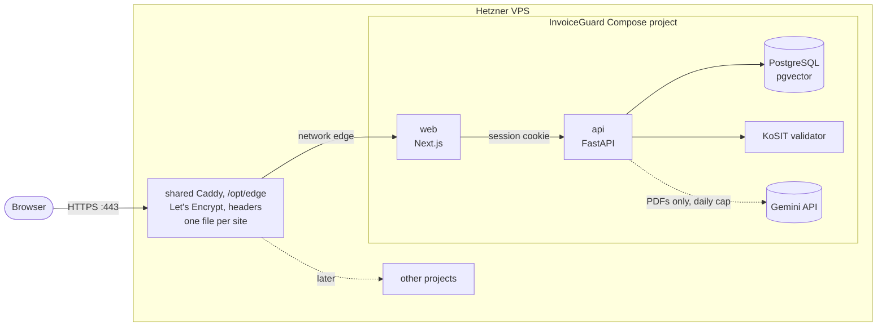

# Deploying the public demo

The demo runs on one Hetzner Cloud VPS with the Docker Compose stack plus a production override
([ADR-014](decisions/ADR-014-demo-hosting-single-vps.md)). One shared Caddy (`/opt/edge`, from
[`infra/edge`](../infra/edge)) serves every site on the server over HTTPS and is the only container with public
ports. InvoiceGuard's web container joins Caddy's `edge` network; the API, validator and database stay on the
project's own network.



Placeholders: `<IP>` is the server's IPv4 address, `invoiceguard.ziadalghawi.com` the demo's host name.

## 1. Create the server (Hetzner Cloud Console)

1. **Server:** location Nuremberg or Falkenstein; image Ubuntu 24.04 LTS; type shared vCPU x86 with 2 vCPU and
   4 GB RAM (the KoSIT validator and the web build need the memory); public IPv4 and IPv6; your SSH public key;
   name `invoiceguard-demo`. No password login.
2. **Firewall** (Firewalls → Create), applied to the server. Inbound rules:
   - TCP 22 (SSH), ideally from your own IP only
   - TCP 80 (HTTP, for the certificate challenge and the redirect)
   - TCP 443 and UDP 443 (HTTPS, HTTP/3)

   Use this firewall rather than `ufw`: ports that Docker publishes skip the host's `ufw` rules, while the
   Hetzner firewall filters traffic before it reaches the VM.

## 2. DNS (Namecheap → Domain List → ziadalghawi.com → Advanced DNS)

Add a new record:

| Type | Host | Value | TTL |
| --- | --- | --- | --- |
| A Record | `invoiceguard` | `<IP>` | Automatic |

An AAAA record with the IPv6 address is optional. Check it before starting Caddy, which needs it to get a
certificate: `nslookup invoiceguard.ziadalghawi.com` must answer `<IP>` (usually within minutes).

## 3. Prepare the server (once, as root)

```sh
ssh root@<IP>

# Security updates install themselves.
apt-get update && apt-get -y upgrade
apt-get install -y unattended-upgrades git make
dpkg-reconfigure -f noninteractive unattended-upgrades

# 2 GB swap, so building the images cannot run the 4 GB server out of memory.
fallocate -l 2G /swapfile && chmod 600 /swapfile && mkswap /swapfile && swapon /swapfile
echo '/swapfile none swap sw 0 0' >> /etc/fstab

# Docker Engine and the Compose plugin from Docker's apt repository.
install -m 0755 -d /etc/apt/keyrings
curl -fsSL https://download.docker.com/linux/ubuntu/gpg -o /etc/apt/keyrings/docker.asc
chmod a+r /etc/apt/keyrings/docker.asc
echo "deb [arch=$(dpkg --print-architecture) signed-by=/etc/apt/keyrings/docker.asc] \
https://download.docker.com/linux/ubuntu $(. /etc/os-release && echo "$VERSION_CODENAME") stable" \
  > /etc/apt/sources.list.d/docker.list
apt-get update
apt-get install -y docker-ce docker-ce-cli containerd.io docker-buildx-plugin docker-compose-plugin

# A deploy user for day-to-day work, with the same SSH key. Membership in the docker group is
# root-equivalent; it only saves typing sudo, it is not a security boundary.
adduser --disabled-password --gecos "" deploy
usermod -aG docker deploy
install -d -m 700 -o deploy -g deploy /home/deploy/.ssh
install -m 600 -o deploy -g deploy /root/.ssh/authorized_keys /home/deploy/.ssh/authorized_keys

# SSH: keys only, no root login. Test `ssh deploy@<IP>` in a second terminal before closing this one.
printf 'PermitRootLogin no\nPasswordAuthentication no\n' > /etc/ssh/sshd_config.d/10-hardening.conf
systemctl reload ssh

install -d -o deploy -g deploy /opt/invoiceguard /opt/edge
```

## 4. Start the shared Caddy (as deploy, once per server)

```sh
ssh deploy@<IP>
git clone https://github.com/Ziad-Alghawi/invoiceguard.git /opt/invoiceguard
cp -r /opt/invoiceguard/infra/edge/. /opt/edge/
cd /opt/edge && docker compose up -d     # creates the `edge` network and starts Caddy on 80/443
```

`/opt/edge` belongs to the server, not to one project: later sites add their own file there. Until InvoiceGuard
runs, its site answers `502`.

**Adding another site later:** write `/opt/edge/sites/<name>.caddy` (copy `invoiceguard.caddy`: host name,
`import security_headers`, `reverse_proxy <alias>:<port>`), attach the app's public container to the external
network `edge` with a unique alias (see `infra/docker-compose.prod.yml`), add a DNS A record, then:

```sh
cd /opt/edge
docker compose exec caddy caddy validate --config /etc/caddy/Caddyfile   # a broken file stops every reload
docker compose exec caddy caddy reload --config /etc/caddy/Caddyfile     # no restart, no downtime
```

## 5. Configure and start InvoiceGuard (as deploy)

```sh
cd /opt/invoiceguard
cp .env.example .env && chmod 600 .env
```

Edit `.env` (`nano .env`). Never commit it or copy it anywhere else:

| Variable | Value |
| --- | --- |
| `POSTGRES_PASSWORD` | output of `openssl rand -hex 24` |
| `INVOICEGUARD_SEED_USER_EMAIL` | `demo@example.com` (shown on the login page) |
| `INVOICEGUARD_SEED_USER_PASSWORD` | output of `openssl rand -hex 12` (shown on the login page on purpose; random so it is no password used anywhere else) |
| `INVOICEGUARD_SEED_USER_NAME` | `Demo Reviewer` |
| `INVOICEGUARD_SEED_APPROVER_EMAIL` | `approver@example.com` (shown on the login page; confirms overrides, ADR-016) |
| `INVOICEGUARD_SEED_APPROVER_PASSWORD` | output of `openssl rand -hex 12` (shown on the login page, like the reviewer's) |
| `INVOICEGUARD_SEED_APPROVER_NAME` | `Demo Approver` |
| `INVOICEGUARD_LLM_API_KEY` | optional: a separate Gemini key with a low quota set in Google AI Studio. Empty: plain PDFs wait |
| `INVOICEGUARD_LLM_DAILY_BUDGET_USD` | optional; the prod override defaults to `0.50` |

The other values keep their defaults. `INVOICEGUARD_DATABASE_URL` is only used outside Docker. Compose builds the
API's database URL from the `POSTGRES_*` values.

```sh
make prod-up      # builds the images, starts db, validator, api and web on `edge`, waits until healthy
make demo-reset   # master data, six sample invoices, the demo logins (reviewer and approver)
```

Open https://invoiceguard.ziadalghawi.com: the login page shows the demo accounts. If the certificate is missing,
look at `cd /opt/edge && docker compose logs caddy` (usually DNS
not pointing at the server yet, or port 80 closed in the firewall).

**Nightly reset** (`crontab -e` as deploy):

```cron
0 3 * * * cd /opt/invoiceguard && make demo-reset >> /home/deploy/demo-reset.log 2>&1
```

## 6. Update

From your own machine, after the change is merged to `main`:

```sh
make deploy       # ssh $DEPLOY_HOST "cd /opt/invoiceguard && git pull && make prod-up"
```

`DEPLOY_HOST` is set in your local `.env` (for example `deploy@<IP>`; it stays empty on the server). Without it,
`make deploy` stops with a message and does nothing. `make prod-up` rebuilds changed images and recreates changed
containers; migrations run at api start. The same by hand:

```sh
ssh deploy@<IP>
cd /opt/invoiceguard
git pull
make prod-up
```

If `infra/edge/sites/invoiceguard.caddy` changed: copy it to `/opt/edge/sites/` and reload Caddy (above).

Roll back with `git checkout <previous commit or tag> && make prod-up`. A migration is not undone that way:
`docker compose ... exec api alembic downgrade -1` first, if the new release added one.

## 7. Operate

| Task | Command (in `/opt/invoiceguard`) |
| --- | --- |
| Status | `cd infra && docker compose --env-file ../.env -f docker-compose.yml -f docker-compose.prod.yml ps` |
| Logs | same, with `logs --tail 100 api` (or `web`, `validator`, `db`); Caddy: `cd /opt/edge && docker compose logs caddy` |
| LLM cost today | `... exec db psql -U invoiceguard -c "select sum(cost_usd) from model_calls where at >= current_date"` |
| Reset the demo now | `make demo-reset` |
| Stop | `make prod-down` (data stays in volumes; Caddy and other sites keep running) |
| Disk | `df -h /` and `docker system df`; `docker image prune` after updates |

Container logs rotate at 3 × 10 MB per container. Caddy writes no access log, because visitor IP addresses
are personal data and the demo does not need them. There is no backup: the demo holds only sample data and is
reset every night.
